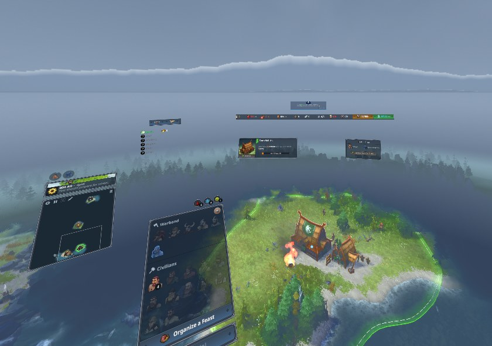

# Northgard VR

VR mod for Northgard: the map on a table in front of you, controller laser input, HUD panels around you.

Unofficial, not affiliated with Shiro Games. Requires Northgard on Steam. No game files are included or changed.

**[Download](https://github.com/SoakingRich/Northgard-VR-Mod/releases/latest)** · [Changelog](CHANGELOG.md) · [Issues](https://github.com/SoakingRich/Northgard-VR-Mod/issues)

Beta. Tested: Quest 3 via Virtual Desktop. Other OpenXR headsets untested.

## Install

1. Extract the release zip.
2. Run `NorthgardVR_Setup.exe` (unsigned: *More info → Run anyway*).
3. Start your VR runtime, then the **Northgard VR** shortcut. Steam must be running.

Steam's Play button still starts the normal game. Uninstall: `NorthgardVR_Setup.exe /uninstall`.

## Controls

| Input | Action |
|---|---|
| Trigger | Click / give orders to selected units |
| A | Select, hold to drag a box |
| B | Cancel building placement |
| Grip | Drag map (both grips: zoom, rotate) |
| Right stick | Rotate, zoom |
| Left stick X | Table size |
| Y | Reset view |
| Left ≡ / right stick click | Escape |
| Left stick click | VR options |

Index: same, Escape = right stick click. Vive: trackpad = stick, right menu = B. WMR: trackpad click = A.

## Notes

- Ranked matches show on a flat screen in VR.
- Mixed reality (Virtual Desktop): set the key colour shown in VR options under *Streaming → VR Passthrough → Configure*.
- Problems: VR options → Log → Open folder, attach `NorthgardVR_log.txt` to an issue.

## Known issues

- Snow can appear in winter with Weather off.
- Chroma key can tint transparent panels.

[Advanced settings](docs/ADVANCED.md) · [Building from source](docs/DEVELOPMENT.md) · MIT licence
