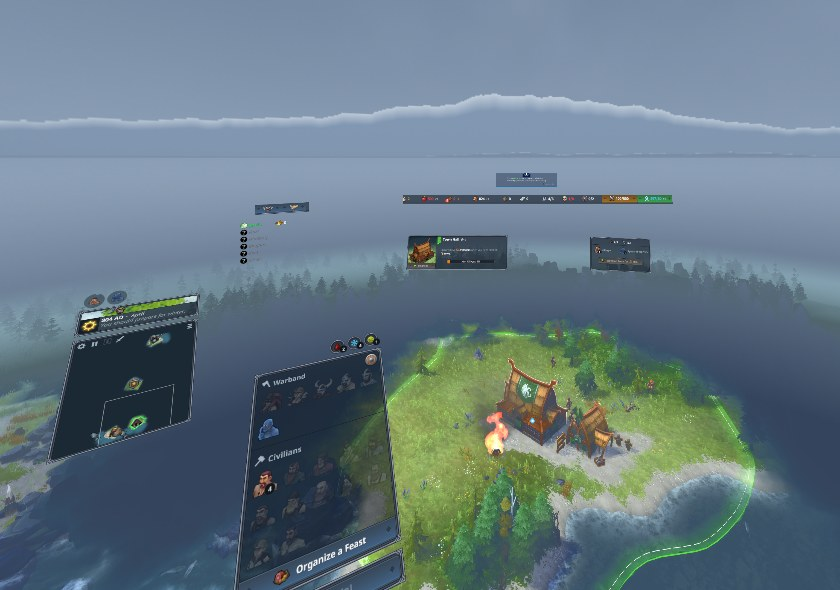

# Northgard VR public release battle plan

{ .release-hero loading=lazy }

> **Release state: 🟡 HARDENING**
>
> **Candidate version:** `v0.9.1` · **Target date:** TBD  
> **Decision owner:** Alex · **Build and simulator owner:** Codex  
> **Candidate commit:** not frozen · **Last updated:** 2026-11-07
{: .release-summary }

[Engineering tasks](https://github.com/SoakingRich/Northgard-VR-Mod/blob/main/docs/Tasks.md){ .md-button .md-button--primary }
[Regression checklist](https://github.com/SoakingRich/Northgard-VR-Mod/blob/main/docs/RELEASE_CHECKLIST.md){ .md-button }
[Changelog](https://github.com/SoakingRich/Northgard-VR-Mod/blob/main/CHANGELOG.md){ .md-button }
[Issues](https://github.com/SoakingRich/Northgard-VR-Mod/issues){ .md-button }

## Mission

Ship a stable, understandable public beta update that installs cleanly, keeps
vanilla Northgard untouched, works on the primary Quest 3 + Virtual Desktop setup,
and gives early players enough information to report useful bugs.

This page is the launch dashboard. Detailed engineering work stays in
[`docs/Tasks.md`](https://github.com/SoakingRich/Northgard-VR-Mod/blob/main/docs/Tasks.md),
and individual regression cases stay in
[`docs/RELEASE_CHECKLIST.md`](https://github.com/SoakingRich/Northgard-VR-Mod/blob/main/docs/RELEASE_CHECKLIST.md).

## Status key

| Mark | Meaning | Mark | Owner |
|---|---|---|---|
| ✅ | Passed, with evidence | **A** | Alex — decisions and headset testing |
| 🟡 | In progress or awaiting a decision | **C** | Codex — code, build and simulator testing |
| ⬜ | Not started | **T** | Community tester |
| ⛔ | Release blocker | 🧪 / 🥽 | Simulator / physical-headset evidence |

## Gates at a glance

| Gate | Owner | State | Exit condition |
|---|:---:|:---:|---|
| G0 — Candidate and tag safe | A/C | 🟡 | Reviewed candidate commit; `v0.9.1` tag points to that exact commit |
| G1 — Blocking defects closed | A/C | 🟡 | No unresolved crash, freeze, install, data-loss or primary-control blocker |
| G2 — Release package proved | C | 🟡 | Current clean GitHub build succeeds; downloaded zip passes archive and install checks |
| G3 — Simulator regression green | C | ⬜ | Full release checklist passes against the packaged candidate |
| G4 — Primary headset accepted | A | ⬜ | Quest 3 + Virtual Desktop / VDXR passes the required headset checks |
| G5 — Compatibility claims honest | A/C | ⬜ | SteamVR, Link, GPU and controller claims match actual evidence |
| G6 — Docs, media and support ready | A/C | 🟡 | A new player can install, launch, troubleshoot, report and uninstall unaided |
| G7 — Final go/no-go | A | ⬜ | Every required gate signed off and Alex records an explicit **GO** |

## Release contract

- **Primary launch target:** Quest 3 through Virtual Desktop using VDXR.
- **Other runtimes:** SteamVR and Quest Link must be tested or clearly labelled
  experimental before launch.
- **Controllers:** Quest Touch is the primary target. Index, Vive and WMR remain
  best-effort until tested on real hardware.
- **Game scope:** single-player focused. Multiplayer warns but is never blocked;
  Ranked stays on a flat screen inside VR.
- **Installation:** standalone launcher and installer. Steam's normal Play button
  always launches vanilla Northgard.
- **Distribution:** unsigned, unofficial and provided as-is. GitHub Releases is the
  first launch channel; Nexus Mods is a later, separate decision.
- **Visibility:** a tag-triggered GitHub release may be public before the announcement.
  That is acceptable; announcement waits for a smoke test of the public asset.
- **Scope freeze:** after the candidate is frozen, only release blockers,
  documentation and release tooling enter it.

### What blocks release

A repeatable crash, desktop or VR freeze, corrupt or lost game state, broken clean
install, loss of normal Northgard access, unusable primary control, or failure on
Quest 3 + VDXR is a blocker. A cosmetic issue may ship only when it is understood,
accepted by Alex and visible in Known Issues before download.

## Phase 0 — Freeze the candidate

- [x] Accept the existing public `v0.9.0` release as the immutable baseline and use
  `v0.9.1` for the current candidate.
- [x] Verify `v0.9.0` on GitHub: tag and public release both point to `c5934c5`.
- [x] Accept that the tag-triggered release may be public before announcement; no
  draft or `-rc.1` staging gate is required.
- [ ] Review and consolidate the current dirty working tree without discarding
  unrelated work.
- [ ] Record the candidate commit SHA, Northgard version and build date.
- [ ] Create `v0.9.1` only after the final candidate commit is reviewed; never move
  the published `v0.9.0` tag.
- [ ] Freeze non-blocking feature work.

**Gate G0 evidence**

| Candidate | Commit | Northgard version | Built | Tag verified by |
|---|---|---|---|---|
| `v0.9.1` | Not frozen | Record at freeze | — | — |

## Phase 1 — Close or accept blockers

- [ ] Fix Weather = Off still showing snow/weather particles, or explicitly accept
  and disclose it.
- [ ] Verify off-hand-trigger selection of an individual unit adds/removes it from
  the current selection.
- [ ] Verify off-hand-trigger drag selection adds the box result to the current
  selection.
- [ ] Verify ordinary Unit Tallies click cycles one unit, while off-hand trigger +
  click adds every unit of that type.
- [ ] Recheck X and right-stick click opening the pause menu on real hardware under
  both VDXR and SteamVR.
- [ ] Confirm all interruption paths clear held mouse/Shift state without a repeat
  click or stuck modifier.
- [ ] Review parked issues and promote only reproducible, release-impacting failures.

**Gate G1 rule:** unresolved blockers stop the launch. Accepted non-blockers must
appear in README Known Issues and the release notes.

## Phase 2 — Prove the build and package path

- [ ] Add the currently untracked `THIRD_PARTY_NOTICES.txt` and
  `tools/hlbc/LICENSE` to the candidate; the release script requires both in a clean
  checkout.
- [x] Prove `.github/workflows/release.yml` on GitHub: main run `41765514049` and
  `v0.9.0` tag run `41772237123` both succeeded on 2026-11-04.
- [ ] Run the workflow successfully for the current `v0.9.1` candidate before tagging.
- [ ] Confirm the workflow builds from a clean checkout, not from local leftovers.
- [ ] Download the workflow artifact and inspect it; do not substitute a local build.
- [ ] Confirm the embedded version agrees in the zip name, log, VR menu, changelog
  and release title.
- [ ] Install from the downloaded zip and test first-run patching plus second-run
  patch skipping.
- [ ] Record and publish the zip's SHA-256 checksum.
- [ ] Retain the exact tested artifact and evidence for rollback/reproduction.

Expected archive contents:

| Required | Purpose |
|---|---|
| `openxr.hdll` | VR runtime integration |
| `NorthgardVR.exe` | Standalone launcher |
| `NorthgardVR_Setup.exe` | Installer and uninstaller |
| `hlpatch.exe` | Generates `vrboot.dat` from the player's current game |
| UI layout and notification rules | Shipped configuration |
| Sky assets | Generated release assets |
| README, changelog, licences and notices | Installation, history and attribution |

`vrboot.dat` is intentionally absent: the launcher creates it from each player's
own `hlboot.dat`.

> **Workflow decision:** pushing the final tag creates a normal public GitHub release
> immediately. Alex accepts that visibility. Smoke-test the resulting public asset
> before announcing it, and never move a published tag.
{: .release-note }

## Phase 3 — Simulator regression

Run the complete
[release checklist](https://github.com/SoakingRich/Northgard-VR-Mod/blob/main/docs/RELEASE_CHECKLIST.md)
against a clean install from the packaged candidate.

- [ ] Install, first patch, second launch and version-display checks pass.
- [ ] Flat menu, load-save and laser interaction checks pass.
- [ ] Tabletop controls, additive selection and Unit Tallies checks pass.
- [ ] Pause, dialogs, Save/Load and Quit to Title checks pass.
- [ ] VR options, controls guide, first-entry notification and persistence pass.
- [ ] Standard and Ranked debug paths pass.
- [ ] Quit, repatch and uninstall checks pass.
- [ ] Test evidence names the exact candidate SHA and artifact checksum.

## Phase 4 — Headset and runtime acceptance

| Setup | Launch requirement | Owner | Result | Evidence / limitation |
|---|:---:|:---:|:---:|---|
| Quest 3 + Virtual Desktop / VDXR | Required pass | A | ⬜ | Primary supported path |
| Quest 3 + SteamVR runtime | Pass or label experimental | A | ⬜ | Verify pause/menu mapping |
| Quest 3 + Quest Link runtime | Pass or label experimental | A | ⬜ | — |
| NVIDIA GPU | Record primary result | A | ⬜ | Record model and driver |
| AMD GPU | Tester or label unverified | T | ⬜ | Do not claim support without evidence |
| Index controller | Tester or label unverified | T | ⬜ | Capture `controller profile:` log |
| Vive controller | Tester or label unverified | T | ⬜ | Capture `controller profile:` log |
| WMR controller | Tester or label unverified | T | ⬜ | Capture `controller profile:` log |

Required primary-headset checks:

- [ ] Launcher-started game connects to Steam; login and an achievement-capable save
  behave normally.
- [ ] Initial tabletop entry, first-use notification and core controls work.
- [ ] HUD row, HUD distance and hand-menu aim are comfortable and readable.
- [ ] Off-hand selection modifier behaves correctly in a real match.
- [ ] Pause, confirmation, Save/Load and Quit to Title work.
- [ ] Main-menu Quit returns Steam to **PLAY** without manual recovery.
- [ ] Weather fog follows map dragging.
- [ ] Mixed-reality instructions match observed Virtual Desktop behaviour.
- [ ] A meaningful play session covers alt-tab and headset sleep/wake.
- [ ] No sustained frame-rate or comfort regression appears on the primary setup.

## Phase 5 — Documentation, media and support

- [ ] Reconcile the README's release wording with the still-unreleased changelog and
  project state.
- [ ] Validate or soften CPU/GPU minimums until broader GPU evidence exists.
- [ ] Validate or soften absolute passthrough/120 Hz claims unless reproduced.
- [ ] List every accepted runtime, controller, weather and chroma-key limitation.
- [ ] Confirm clean-machine installation and uninstall instructions.
- [ ] Explain the unsigned-binary / SmartScreen warning without implying a signature.
- [ ] Capture final tabletop, controls and menu screenshots.
- [ ] Record a short install/gameplay video.
- [ ] Prepare release notes with install, compatibility, known issues and support.
- [ ] Prepare one bug-report route that asks for release version, Northgard version,
  runtime, headset, GPU/driver, controller profile, reproduction steps and
  `NorthgardVR_log.txt`.
- [ ] Decide separately whether and when to publish on Nexus Mods.

## Final go / no-go

Do not push the next release tag until every required item is checked:

- [ ] Candidate commit and version are frozen.
- [ ] Tag target is exact and safe; no published tag is moved.
- [ ] CI builds the package from a clean checkout.
- [ ] Downloaded workflow artifact passes fresh install, update and uninstall.
- [ ] Full simulator regression passes against the recorded artifact.
- [ ] Quest 3 + VDXR final-candidate acceptance passes.
- [ ] SteamVR and Link results or experimental labels are recorded.
- [ ] Steam login and clean quit pass on the headset.
- [ ] No unresolved crash, freeze, stuck-input, corruption or installer blocker.
- [ ] Version, changelog, release notes and archive name agree.
- [ ] Every accepted limitation is visible before download.
- [ ] Screenshots, support route, licences and checksum are ready.
- [ ] Alex gives explicit **GO**.

> **Decision:** ⬜ GO · ⬜ NO-GO  
> **Decision date:** —  
> **Candidate SHA / checksum:** —  
> **Signed off by:** —
{: .release-decision }

## Launch sequence

### T−60 minutes

- [ ] Freeze changes and record the candidate SHA.
- [ ] Download, inspect and hash the workflow-built artifact.
- [ ] Perform the final clean-install smoke test.
- [ ] Verify the version/tag strategy one last time.

### T−15 minutes

- [ ] Finalize release notes, compatibility labels, media and checksum.
- [ ] Confirm issue-reporting links.
- [ ] Confirm release notes are ready for the tag-triggered public release.

### T0

- [ ] Push the approved tag.
- [ ] Wait for the release workflow and inspect its logs.
- [ ] Download and install once from the release asset itself.
- [ ] Smoke-test the public release asset; if it fails, warn immediately and issue a
  new version rather than moving the published tag.
- [ ] Verify the release page and download link, then announce.

### T+60 minutes

- [ ] Check early download and issue reports.
- [ ] Pin the reporting template and current known issues.
- [ ] Escalate launch blockers; do not mix opportunistic features into a hotfix.

## Post-release watch

### First 24 hours

- [ ] Triage every reproducible install failure, crash, freeze, runtime-startup,
  Steam-login or primary-control report.
- [ ] Add confirmed problems to Known Issues immediately.
- [ ] Hotfix only release-critical failures.

### At 72 hours

- [ ] Group reports by runtime, GPU and `controller profile:`.
- [ ] Decide whether a `v0.9.1` hotfix is needed.
- [ ] Update the compatibility matrix from real evidence.

### After one week

- [ ] Summarize recurring issues and support load.
- [ ] Decide whether to publish on Nexus Mods.
- [ ] Move non-urgent feedback into the normal backlog.

## Risk register

| Risk | Warning signal | Mitigation | Owner | State |
|---|---|---|:---:|:---:|
| Reusing or moving a published tag | New build does not match the tag's source | Keep `v0.9.0` immutable; create `v0.9.1` only from the frozen candidate | A/C | ✅ |
| Clean CI build lacks required files | Release script cannot copy notices/licence | Track both currently untracked release inputs | C | ⛔ |
| Northgard update changes bytecode | Patch or launch failure | Name-based repatch, patch log and fast compatibility smoke test | C | 🟡 |
| Runtime-specific input mismatch | Wrong or missing buttons | Test VDXR/SteamVR/Link; capture active controller profile | A/C | 🟡 |
| Unsigned binaries trigger warnings | SmartScreen or antivirus report | Clear warning, checksum and reproducible CI artifact | A/C | 🟡 |
| AMD or alternate-controller regression | Community tester report | Honest matrix; never promote untested hardware to supported | A | ⬜ |
| Long-session or sleep freeze | Session stalls after idle/alt-tab | Extended headset pass and useful logs | A | ⬜ |
| Weather/chroma visual defects | Snow or tinted transparent panels | Fix or disclose with reproduction details | A/C | 🟡 |
| Support reports lack evidence | Repeated incomplete issues | One report template with environment and log fields | A | ⬜ |

## Evidence log

Passing a checkbox without naming the build and environment is not release evidence.

| Date | Candidate / checksum | Environment | Result | Evidence link or note |
|---|---|---|---|---|
| 2026-11-07 | `v0.9.0` / `c5934c5` | GitHub release and Actions | ✅ Public baseline | Both main and tag builds succeeded; asset SHA-256 `26ce2cf68eaaeca764227afd43b1ab43721343b83717a5ab64f75d5c1c51e3e7` |
| 2026-11-07 | `v0.9.1` candidate | Local repository | 🟡 Version chosen | Candidate commit is not frozen yet |
| | | | | |
| | | | | |

## Decision log

| Date | Decision | Why | Owner |
|---|---|---|:---:|
| 2026-11-07 | Quest 3 + VDXR is the primary launch target | Matches the project's tested hardware path | A |
| 2026-11-07 | Public before announcement is acceptable | Smoke-test the public asset, then announce; no draft gate needed | A |
| 2026-11-07 | Current candidate is `v0.9.1` | `v0.9.0` is already public and remains immutable | A/C |
| | | | |

## Notes and additions

Add ideas here first. Promote an item into a gate only if it can change the go/no-go
decision.

- [ ] 

## Editing and viewing this plan

Edit `docs/index.md`. While the local preview is running, saving the file refreshes
the rendered page automatically. To start it again from the repository root:

```powershell
build\release-plan-venv\Scripts\zensical.exe serve --dev-addr 127.0.0.1:8765
```

To regenerate the static files without running a server:

```powershell
build\release-plan-venv\Scripts\zensical.exe build --clean --strict
```

The generated website is written to `build/release-site/`; it is intentionally
ignored by Git.
